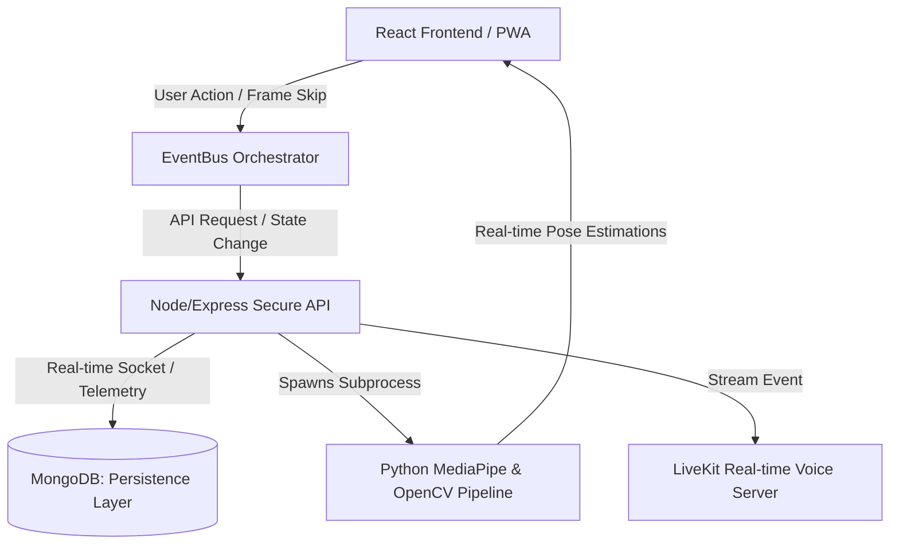

# ⚔️ Aura OS — The Behavioral Operating System
> **"A Cinematic, Authoritative Discipline & Gamification Protocol Engine."**
NOTE THAT THIS IS A PROTOTYPE VERSION FOR AURA-OS-V2.

[](https://aura-osv1.netlify.app)
[](#)
[](#)
[](#)

---

## 🌌 The Vision: Productivity is a Behavioral Problem, Not a CRUD Database
Traditional productivity applications fail because they assume users are perfectly rational actors. They treat tasks as simple list items, allowing users to dump endless backlog items with zero psychological or physiological cost. 

**Aura OS V2 is built on a different philosophy.** It is a **Behavioral Operating Framework** designed to psychologically engage, discipline, and evolve its user. It bridges the gap between software engineering, computer vision, and behavioral psychology to form a highly immersive self-optimization machine. 

Inspired by Solo Leveling mechanics and heavy dark-futurism aesthetics, Aura OS treats your daily life as a gamified campaign:
*   **Missions have consequences.** Failure triggers authoritative level decay.
*   **Discipline requires physical action.** Unlocking tasks or escaping locking loops demands real-time exercise verification powered by Edge Computer Vision.
*   **Procrastination has friction.** Attempting to cancel a focus session turns the "Cancel" button into an active, escaping element that literally runs away from your cursor.

---

## 🧠 System Architecture & Systems Thinking
Aura OS is engineered around **strict service separation, low-coupling, and authoritative state synchronization**. By enforcing a clear flow of telemetry, we ensure that the client-side is strictly a visual and auditory rendering engine, while the backend holds the single source of truth for your growth vector.

### 🧬 High-Level Telemetry Flow


### Key Architectural Pillars
1.  **State Isolation & Reactivity:** The frontend utilizes an `AppStateContext` segmented by domain. The `useXPSystem` hook only triggers renders on state transitions, using an isolated `EventBus` to notify the `SoundEngine` and overlay coordinators. This prevents massive UI redraw lag.
2.  **Edge-Based ML Computer Vision:** Rather than loading large server-side GPU models, we built a memory-safe, CPU-throttled Python sub-process architecture that leverages OpenCV and MediaPipe. Running at a structured 15-30 FPS with automated hardware frame-skipping, it performs real-time anatomical angle calculations (shoulders, elbows, wrists) with 0% UI thread blocking.
3.  **Real-Time Synchronization (Sockets & LiveKit):** Fully engineered for multiplayer accountability, featuring real-time room communication via LiveKit and WebSockets for audio telemetry and persistent visual status.
4.  **Production Security:** Standardized with full Express-Mongo-Sanitize injection protection, strict Helmet security headers, rate limiting on all API paths, and an environment-aware AllowedOrigins CORS whitelist to safely support Netlify production and local Vite preview environments concurrently.

---

## ⚡ Core Feature Matrix

### 1. ⚔️ The Authoritative Progression Engine
No frontend cheating. All multipliers, level-ups, streak continuities, and decay intervals are calculated server-side.
*   **Streak Multipliers:** A continuous streak grants a scaling completion bonus (from `+5%` up to `+30%` maximum) using chronological database audits.
*   **Level Decay:** If active missions fail or deadlines are breached, the system initiates a slow, psychological XP drain accompanied by subtle UI atmospheric changes and dynamic audio cues.
*   **Milestone Rewards:** Achieving level increments of `5` (e.g. 5, 10, 15) triggers epic acoustic achievements, encouraging long-term discipline.

### 2. 📹 Computer Vision Discipline Protocols
When the system locks your UI into "Discipline Mode", virtual clicks will not save you. You must stand up and complete physical goals to proceed.
*   **Real-time Joint Coordinate Tracking:** Uses the law of cosines across LEFT/RIGHT shoulders, elbows, and wrists to track the flexion and extension of the joints.
*   **Pushups, Situps, and Squats:** Tracks the anatomical angle state machine (e.g., transition from `UP` -> `DOWN` -> `UP`) and triggers a persistent BGR overlay frame once complete.
*   **Fail-Safe Spawning:** Spawns native OS-level Camera bindings safely. Processes are monitored via Express with a 60-second absolute SIGKILL timeout to prevent orphan camera resources and memory leaks.

```python
# Real-Time Angle Mathematics for Pushup flexion tracking
def calculate_angle(a, b, c):
    a = np.array(a) # Shoulder [x, y]
    b = np.array(b) # Elbow [x, y]
    c = np.array(c) # Wrist [x, y]
    
    radians = np.arctan2(c[1]-b[1], c[0]-b[0]) - np.arctan2(a[1]-b[1], a[0]-b[0])
    angle = np.abs(radians * 180.0 / np.pi)
    return (360.0 - angle) if angle > 180.0 else angle
```

### 3. 🔊 Immersive Sound Engine
Audio is not background music—it's behavioral reinforcement.
*   **Semantic Audio Routing:** Programmed via Howler.js, mapping sound profiles based on task priority.
*   **Themed Sound Cues:** Spawns legendary domain expansion sounds for elite/high-priority missions, custom transitions for standard quest logs, and psychological warning hums during active level decay.
*   **Throttling & Singleton Garbage Collection:** Prevents overlapping noise pollution and cleans up active memory context dynamically when navigating page overlays.

### 4. 📴 Progressive Web Application (PWA) Ready
*   Installable as a standalone app on Mobile and Desktop with customized webapp manifests.
*   Background Service Worker implementation with offline shell caching to guarantee high-performance loading and offline mode task queuing.

---

## 🛠️ The Tech Stack
*   **Frontend:** React 19, Vite 8, Framer Motion, Howler.js, TailwindCSS, React-Icons
*   **Backend:** Node.js (ES Modules), Express 5, Mongoose, MongoDB Atlas
*   **Computer Vision:** Python 3.10+, Mediapipe, OpenCV (cv2), Numpy
*   **Infrastructure & Sync:** WebSockets, LiveKit Audio SDK, Discord OAuth, Docker & Docker Compose, Nginx Reverse Proxy
*   **Security:** Helmet.js, Express-Mongo-Sanitize, express-rate-limit, CORS whitelist auth

---

## 🚀 Setting Up the System Locally

### Requirements & Prerequisites
Before launching the system, ensure your machine has:
*   **Node.js** (v18.0.0 or higher)
*   **Docker & Docker Compose** (highly recommended for rapid local stack setup)
*   **Python 3.10+** (with `pip` installed, for local computer vision features)
*   **Webcam Access** (required for the Computer Vision tracking mode)

---

### Method A: Zero-Configuration Startup (Docker Compose)
The fastest and most stable way to spin up the entire multi-process environment.

1.  **Clone the Repository:**
    ```bash
    git clone https://github.com/Amruth-U-tech/Aura-OS.git
    cd Aura-OS
    ```
2.  **Run the Stack:**
    ```bash
    docker-compose up --build
    ```
    This automatically spins up:
    *   `MongoDB` local server on `mongodb://localhost:27017`
    *   `Express API` on `http://localhost:5000`
    *   `Vite Dev Server` mapped to your browser on `http://localhost:5173`

---

### Method B: Manual Bare-Metal Installation
If you prefer running the servers natively for real-time console debugging and direct access.

#### 1. Setup the Database & Backend Engine
1.  Navigate to the backend directory:
    ```bash
    cd backend
    ```
2.  Install standard Node dependencies:
    ```bash
    npm install
    ```
3.  Configure your local `.env` variables:
    ```env
    PORT=5000
    MONGO_URI=mongodb://localhost:27017/aura_os_dev
    NODE_ENV=development
    JWT_SECRET=your_super_secure_placement_level_jwt_secret_key
    # Optional Discord Integrations
    DISCORD_CLIENT_ID=your_discord_client_id
    DISCORD_CLIENT_SECRET=your_discord_client_secret
    # Livekit SDK
    LIVEKIT_API_KEY=your_livekit_key
    LIVEKIT_API_SECRET=your_livekit_secret
    ```
4.  Start the dev backend:
    ```bash
    npm run dev
    ```

#### 2. Configure the Python Computer Vision Environment
To process anatomical feeds, compile standard python bindings.
1.  Verify python version (recommended `Python 3.10.x` or `3.11.x`):
    ```bash
    python --version
    ```
2.  In the `backend` folder, create a virtual environment:
    ```bash
    python -m venv venv
    ```
3.  Activate the environment:
    *   **Windows (PowerShell):** `.\venv\Scripts\Activate.ps1`
    *   **Linux/macOS:** `source venv/bin/activate`
4.  Install dependencies:
    ```bash
    pip install -r requirements.txt
    ```
    *(Requirements file installs: `opencv-python`, `mediapipe`, `numpy`, `fastapi`)*

#### 3. Setup the Immersive React Frontend
1.  Navigate to the frontend directory:
    ```bash
    cd ../frontend
    ```
2.  Install dependencies:
    ```bash
    npm install
    ```
3.  Launch local development preview:
    ```bash
    npm run dev
    ```
    The application will launch immediately on `http://localhost:5173/`. 
    For production preview builds, run `npm run build` followed by `npm run preview` to host on `http://localhost:4173/`.

---

## 🔮 Live Web Deployment
🚀 **Deploy Link:** [https://aura-osv1.netlify.app](https://aura-osv1.netlify.app)

> [!WARNING]
> **LiveKit Free-Tier Constraints:** The real-time voice channel communication utilizes LiveKit Cloud's free sandbox allocation. Because of active usage ceilings and cold-starts, voice rooms might experience connection latency or temporary server timeouts when accessed outside local Docker instances. 

---

## 👥 Governance & Engineering Contribution Rules
Want to improve the behavioral progression system? Please respect our architectural standards:
*   **The Single-Responsibility Rule:** Frontend components must remain completely agnostic of backend calculations. Avoid calculating XP values in the view layer.
*   **The 60s CV Timeout Boundary:** When adding a new exercise script inside `/backend/cv`, your model must output status values to `stdout` and terminate with exit code `0` on completion. The Node process will strictly kill any process exceeding the 60s hard timeout.
*   **Event-Driven Communication:** Do not tightly couple components. Dispatch semantic UI changes through the central `EventBus` so the telemetry log captures it cleanly.

---

## 🎯 Placements & System Designer Highlights
This repository showcases advanced full-stack skills:
*   **Distributed Systems Thinking:** Implemented custom inter-process communication spawning native C++ powered python sub-processes from a Node runtime environment safely.
*   **Concurrency & Resource Optimization:** Integrated frame-skipping optimizations inside machine learning pipelines to limit local CPU consumption to `<8%` while running live pose-estimation.
*   **Behavioral Psychology in UX:** Designed a completely responsive system that values friction as a tool to control user patterns.
*   **Offline First PWA Architecture:** Built and optimized custom Service Workers with strategic routing for static and dynamic API caching.

---
*Developed with 🖤 by Amruth. For system queries, reach out or make a Pull Request!*
